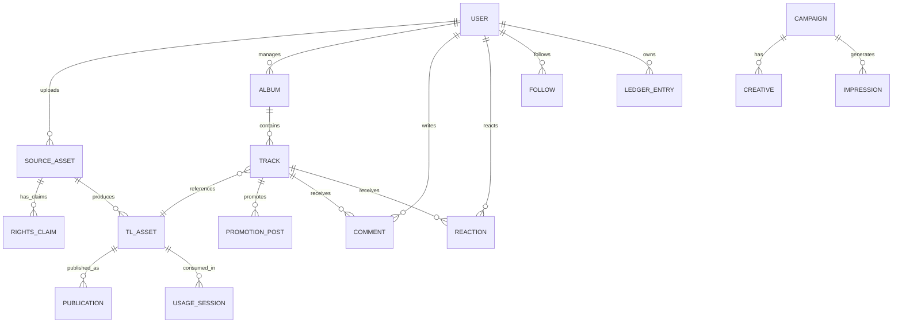

# TimeLink 도메인 및 데이터 모델 v1

- 기준일: 2026-10-14
- 상태: 논리 모델 기준선. 기존 DB 테이블과 매핑하기 전 실제 스키마 검증 필요.
- 목적: 원본 파일·TL 파일·권리·발행·트랙 소셜·개인 파일관리·광고·경제 데이터를 한 모델로 연결한다.

## 1. 핵심 설계 원칙

1. 사용자, 창작자, 업로더, 파일 소유자, 저작권자, 실연자, 음반제작자, 발행 관리자 역할을 분리한다. 한 사람이 여러 역할을 가질 수 있다.
2. 원본(SourceAsset)과 보호 TL 자산(TLAsset)은 별도 객체다.
3. 권리 선언(RightsClaim), 증빙(RightsEvidence), 외부 발매 이력(ExternalReleaseEvidence)은 별도 레코드다.
4. TL 자산을 SharePlace에 공개하는 행위는 Publication으로 분리한다.
5. 앨범과 트랙은 음악 도메인 엔티티이며 Track Page는 트랙 ID에 고정된 공개/관리 뷰다.
6. 공통 Social Core는 모든 지원 자산에 재사용하되, 음악 고유 기능은 Track 도메인에 둔다.
7. TL Economics는 이벤트와 원장을 통해 연결한다. UI 이벤트나 클라이언트 잔액을 경제적 사실로 취급하지 않는다.
8. 기존 D1 테이블을 곧바로 재구성하지 않는다. 먼저 논리 모델을 기존 테이블에 매핑하고, 필요할 때만 단계적 마이그레이션한다.

## 2. 주요 엔티티

### Identity & Roles
- User: 회원 ID, 인증 식별자, 상태, 프로필
- RoleGrant: member, creator, artist, dj, cafe_owner, advertiser, moderator, admin 등 권한 부여 및 유효기간
- ExternalIdentity: 외부 서비스 계정 연결 정보. OAuth 토큰은 암호화 저장하고 비밀값은 서버에만 둔다.

### Asset & File
- SourceAsset: 원본 파일의 논리적 자산. uploader_user_id, owner_claim_id, original_filename, mime, size, sha256, storage_provider, storage_object_id, status, created_at
- TLAsset: 보호된 TL 파일. asset_type(TL3/TL4/TLD/TLJ), source_asset_id, container_version, format_version, content_hash, rights_snapshot_id, storage_ref, status, created_at
- AssetVersion: 원본 또는 TL 자산의 변경·재발행 버전, 이전 버전 참조, 변경 이유
- AssetRelation: derived_from, cover_for, subtitle_for, score_for 등 파일 간 관계
- Publication: TLAsset의 공개 게시 상태, channel, visibility, published_at, revoked_at, publication metadata
- AssetPermission: owner/creator/manager 권한을 분리한 위임·접근 제어 기록

### Rights & Verification
- RightsClaim: claimant_user_id, source_asset_id 또는 tl_asset_id, claim_role, scope, basis, declaration_version, accepted_at, status
- RightsParty: 작품/녹음물에 연결된 창작자·저작권자·실연자·음반제작자·참여자
- RightsEvidence: 증빙 유형, 제출자, 파일/URL/기관, 검증자, 확인 수준, 확인 시각, 만료·취소 상태
- ExternalCatalogConnection: 외부 플랫폼 종류, 외부 계정/아티스트 ID, 연결 소유자, 상태
- ExternalReleaseEvidence: 플랫폼, artist ID, album/track IDs, ISRC 등 식별자, 발매일, 메타데이터 스냅샷, 확인 시각
- RightsDispute: 신고자, 대상 자산, 주장 범위, 증빙, 상태, 조치 및 이의제기 이력

확인 수준은 법률상 소유권을 보증하지 않는다. 외부 발매 이력은 관련성 확인 자료이며, 원본 파일과 발행 권한은 별도 선언/증빙과 함께 판단한다.

### Music Catalog
- ArtistProfile: 사용자 계정과 연결된 아티스트 프로필. 별칭·소개·이미지·외부 프로필 연결
- Album: artist_profile_id, title, release_type(single/EP/album), artwork_asset_id, release_date, description, status
- Track: artist_profile_id, album_id nullable, tl_asset_id, source_asset_id, title, track_number, duration, genre, lyrics_ref, composer/lyricist/arranger credits, ISRC, status
- TrackPublication: Track의 고유 페이지 식별자, 공개 범위, URL slug, page metadata
- PromotionPost: track_id, author_user_id, body, media asset refs, schedule/status, timestamps
- DistributionDelivery: partner, release_id, delivery status, external reference, last sync, error summary

Track은 TL3 파일 그 자체와 동일하지 않다. Track은 곡별 페이지/음악 카탈로그 엔티티이며 하나의 TLAsset 및 여러 버전·발행 상태와 연결될 수 있다.

### Social
- Reaction: user_id, target_type, target_id, reaction_type(like 등), unique key로 중복 방지
- Comment: user_id, target_type, target_id, parent_comment_id nullable, content, status, timestamps
- Follow: follower_user_id, target_type, target_id, created_at
- SavedItem: user_id, target_type, target_id, collection_id
- ShareEvent: actor_user_id, target_type, target_id, channel, share_token, created_at
- Playlist / PlaylistItem: 소유자, 제목, 공개 범위, 순서 및 참조 대상
- Report: 신고자, 대상, 사유, 증빙, moderation status

좋아요·댓글·공유·팔로우·저장 이벤트는 서버에 영속 기록한다. POC 반영은 별도 검증 규칙을 통과한 기여 이벤트만 허용한다.

### Personal Workspace
- UserFileView: 개인 라이브러리 화면을 위한 SourceAsset/TLAsset 참조, 폴더/태그/즐겨찾기
- DashboardSnapshot: 표시용 집계 캐시(원장 원본 아님)
- Notification: 수신자, 유형, 대상, 읽음 상태
- UserActivity: 사용자 활동 이벤트 및 관련 대상

My Files는 새 파일 바이트를 복제하는 테이블이 아니라 개인이 접근할 수 있는 원본/TL 자산을 통합해서 보여주는 논리 라이브러리다.

### Usage & Economy
- UsageAuthorization: user_id, tl_asset_id, scope, permitted duration, start/end, status
- UsageSession: 세션 ID, 사용자, 자산, 시작·종료, player/viewer, policy version
- UsageEvent: 실제 재생·열람 구간, 초/페이지 등 측정량, 검증 결과
- WalletAccount: user_id, asset_code(TL/TLC), account category
- LedgerEntry: debit/credit, amount, reference type/id, idempotency key, policy version, timestamp
- POCEvent: contribution type, validated amount, multiplier, source event, rule version
- TLCEvent: issuance, burn, transfer, mining result, source POC event, rule version
- Settlement: payee, asset, period, gross/net, split rule version, status
- PaymentRecord: PG reference, KRW amount, granted TL, status, reconciliation data

TL, TLC, POC는 같은 컬럼이나 단일 잔액으로 합치지 않는다. 경제적 변경은 원장과 정책 버전을 통해 추적한다.

### Advertising
- AdSource: direct, network, affiliate
- ProviderAccount: 공급자 계정 및 자격증명 참조(비밀값은 secret store)
- Advertiser / Campaign / Creative / Placement
- AdRequest / Impression / Click / CompletionEvent
- ProviderCallback: 서명 검증, 공급자 이벤트 ID, 원문 해시, 처리 결과
- InvalidTrafficReview: 사유, 판정, 조치
- ProviderSettlementStatement: 공급자 보고서·정산
- AdContributionLink: 검증된 광고 활동과 내부 기여 원장의 연결

광고주 예산, 외부 공급자 과금/정산, 사용자 기여/보상은 서로 다른 원장·참조를 사용한다.

## 3. 관계 개요

## 4. 기존 DB 매핑 후보(검증 전)

| 논리 엔티티 | 기존 구현 후보 | 주의 |
|---|---|---|
| User | users | 여러 TL 잔액 필드와 경제 모델 불일치 조사 |
| SourceAsset | tl_files, tl_shares, storage_objects | 테이블별 의미가 혼재되어 있음 |
| TLAsset | tl3_releases, tl3_segments, tl3_tokens, D1 object refs | TL3 v2/v3 및 저장 위치 확인 |
| Publication | tl_shares.shared/release_mode | 게시와 파일 객체가 한 레코드에 결합되어 있음 |
| RightsClaim/Evidence | auth_requests, assets/certify API, disputes | 권리 선언과 실제 증빙 확인 분리 필요 |
| UsageSession/Event | tl3_stream_sessions, play_events, tl3 tokens | 구형/신형 재생 경로 구분 |
| Reaction | 현재 미완성 social routes | 좋아요/팔로우 DB 구현 필요 |
| Comment | social_comments | 댓글 답글/수정/삭제/신고 정책 추가 확인 |
| Playlist | 현재 스텁 routes | 영속 모델 구현 필요 |
| AdCampaign | tl_ads, ad_views | provider/direct source 구분과 이벤트 무결성 필요 |
| LedgerEntry | transactions, tl_payments, tl_exchanges, tlc_mining_v2 등 | 원장 일관성과 중복 지급 방지 확인 |

## 5. 구현 순서

1. 실제 D1 스키마 및 런타임 ALTER 생성 테이블을 전수 수집한다.
2. 각 API가 어떤 테이블을 읽고 쓰는지 매핑한다.
3. 기존 레코드 샘플을 읽기 전용으로 확인한다.
4. 논리 모델과 물리 모델 차이를 문서화한다.
5. 필요 시 신규 테이블을 추가하되 기존 테이블은 즉시 제거하지 않는다.
6. 데이터 이관은 별도 migration + 백업 + 검증 + rollback이 마련된 후 수행한다.
